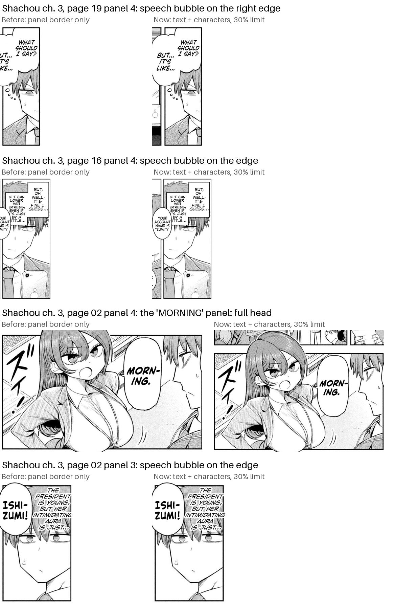
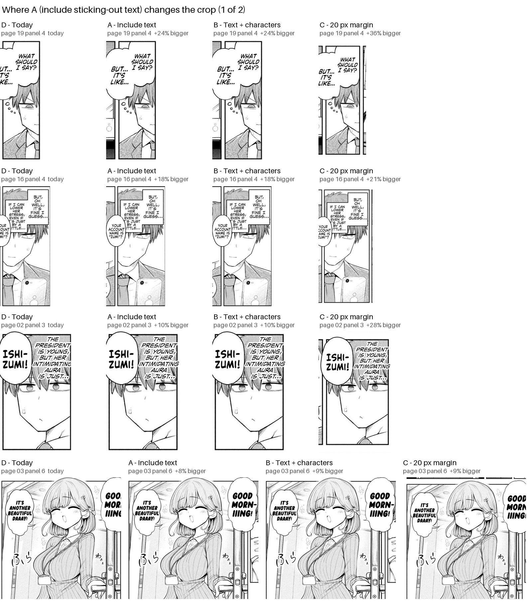
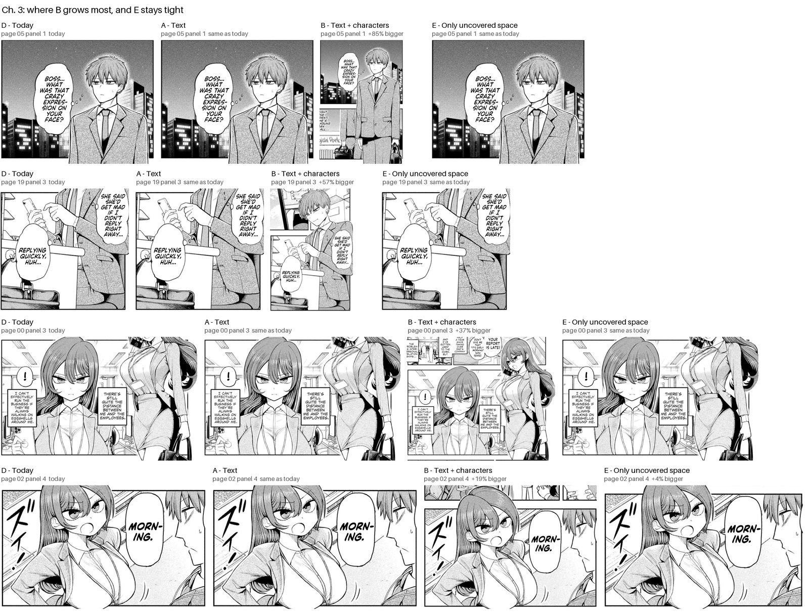
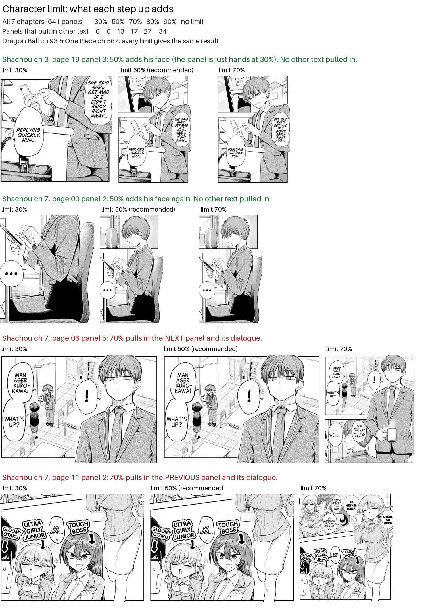
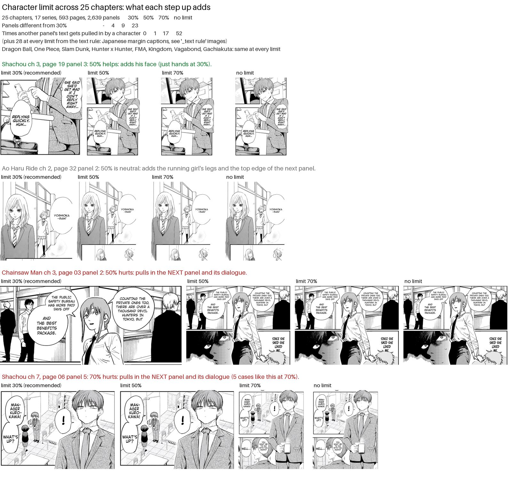
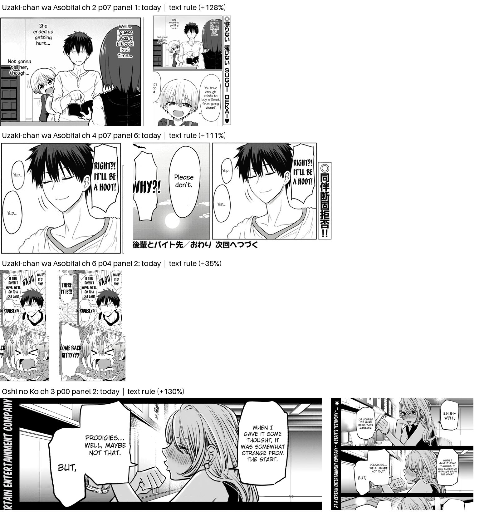
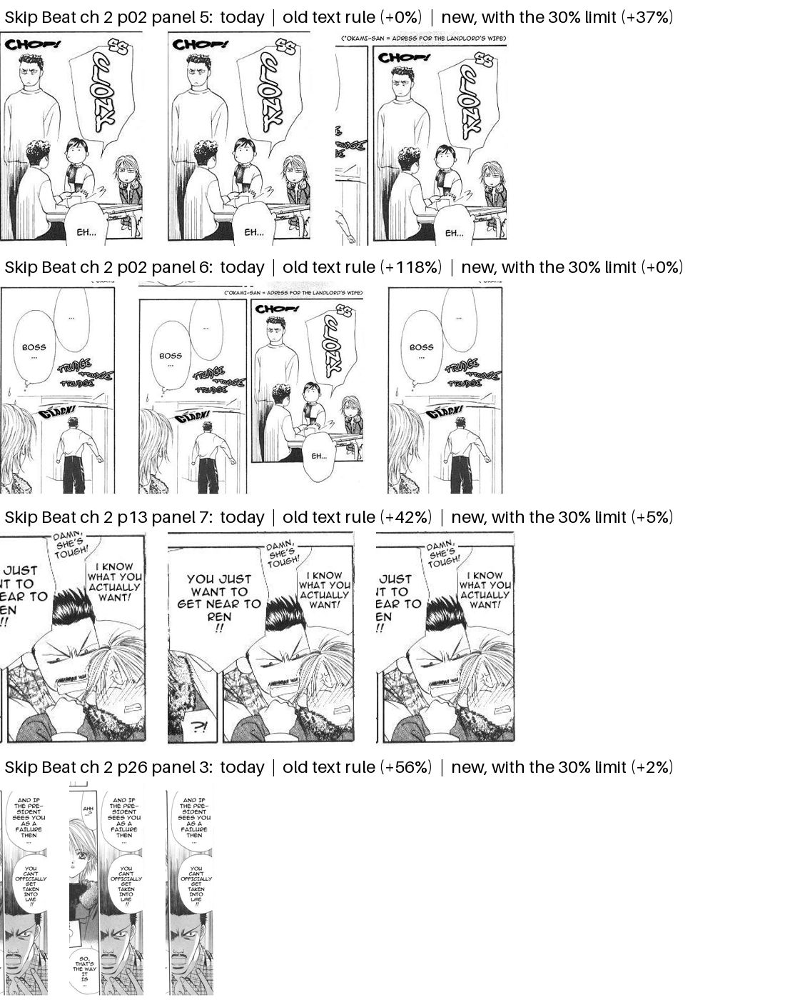
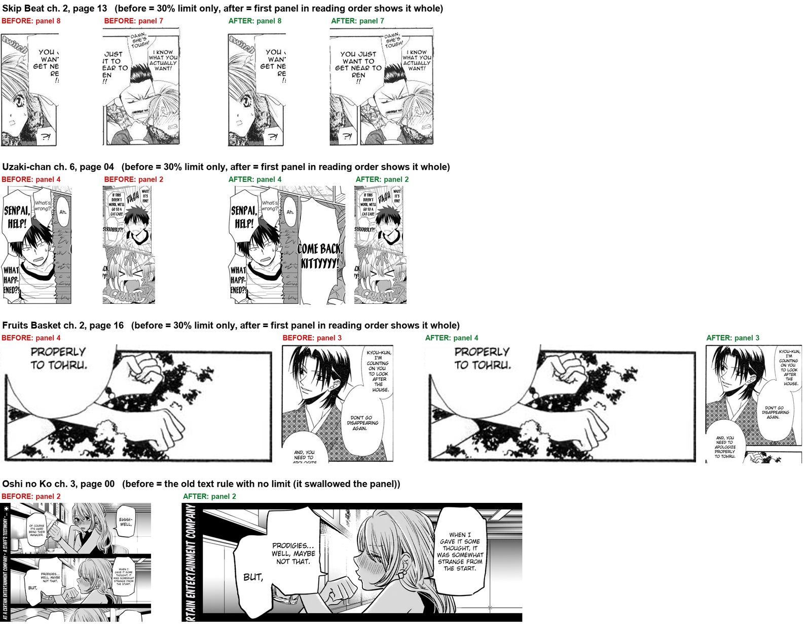
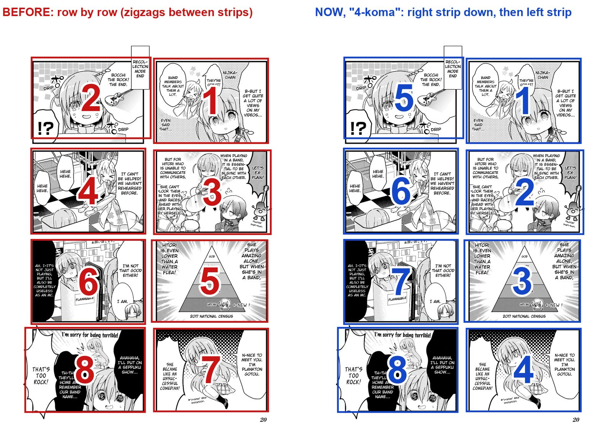

# Panel cropping: keeping speech bubbles and characters whole

Magi finds each panel's **border**. But many artists draw speech bubbles and characters right over the border, so a crop that follows the border cuts them off. This is how Panelyze's crops were fixed, tested on **25 chapters from 17 series (593 pages, 2,639 panels)** across every major manga style.

## The result

| | Before | Now |
|---|---|---|
| Crop | The panel border only | The border, grown to fit the panel's own speech bubbles and characters |
| Speech bubbles sticking out of a panel | Cut off | Kept whole (unless that would take more than 30% of another panel) |
| Characters sticking out of a panel | Cut off | Kept whole (same 30% limit) |
| Speech bubble split between two panels | Cut in both | **Always shown whole in one of them**, even past the 30% limit: the reader needs the words |
| Next panel's dialogue pulled into a crop by a character | Never | **Never** (0 times in the tested chapters) |
| Japanese captions in the page margin | Ignored | Still ignored (the 30% limit skips them) |
| Time (Shachou ch. 3, 27 pages) | 11.0 s to find the panels | **11.3 s to find, grow and save them all**: the text and characters come from the same Magi pass, so growing is nearly free |
| Optional setting | — | **"Show full characters"**: always fits the whole character, even if it takes a lot of another panel |
| 4-koma (comic strips) | Read row by row, which mixed up the strips | New **"4-koma"** reading order: each strip top to bottom, right strip first |

**How it works:** Magi's one detection pass already finds the panels, the text and the characters. Each piece of text and each character belongs to the panel it overlaps most. If it sticks out, the panel grows to fit it, but only if that takes no more than **30%** of any other panel. That keeps a crop from swallowing the next panel and its dialogue. The code is `get_grown_panels` in [magi.py](../magi.py).

## How the rule was found

| Step | Tried | Tested on | Result |
|---|---|---|---|
| 1 | **A:** grow to fit text. **B:** A + characters. **C:** a fixed 20 px margin. **D:** today's crop. | Shachou ch. 3 | A fixes bubbles. B also fixes characters, but sometimes swallows whole neighboring panels (up to +85%). C pulls in neighbors on tight layouts. |
| 2 | **E:** characters only grow into blank space no other panel shows | Shachou ch. 3 | Very tight, but almost the same as A: the character part rarely helped |
| 3 | B with a **limit**: 30%, 50%, 70%, 80%, 90% of another panel, and no limit | Shachou ch. 3–7, Dragon Ball ch. 93, One Piece ch. 567 | 30% and 50% never pulled in other panels' text. 70% and up did (13–34 times). |
| 4 | 30%, 50%, 70% and no limit | **25 chapters, 17 series** | Only 30% never pulled in another panel's text through a character. 50% did once (Chainsaw Man). |
| 5 | The same 30% limit on the text rule too | The 7 chapters where text was a problem | Fixed every margin caption that swallowed a neighboring panel (+111–130% before) |
| 6 | 40% instead of 30%, to show a few more full characters | The 10 chapters where the limit mattered | 40% on text brought the margin captions back. 40% on characters showed 2 more full characters, but in both the extra art was already shown in a neighbor panel. **Kept 30% for both.** |
| 7 | Always show dialogue split between two panels whole in one of them, in the first panel in reading order | Skip Beat, Uzaki-chan, Fruits Basket, Oshi no Ko | 3 bubbles that were cut in both panels are now whole. Titles running down 3+ panels are still left out. |
| 8 | 4-koma reading order | Bocchi the Rock ch. 2 | Strips now read in order |

### Step 1: four ways to crop (Shachou ch. 3)

### Step 2: B grows a lot, E stays tight

On the panels where B grows most, it pulls in big parts of other panels and shows the same character more than once. E leaves those panels as they are.

### Step 3: limits on 7 chapters

Times another panel's speech bubble got pulled into a crop:

| Chapter | 30% | 50% | 70% | 80% | 90% | No limit |
|---|---|---|---|---|---|---|
| Shachou ch. 3 | 0 | 0 | 5 | 5 | 6 | 6 |
| Shachou ch. 4 | 0 | 0 | 0 | 0 | 3 | 5 |
| Shachou ch. 5 | 0 | 0 | 2 | 2 | 2 | 7 |
| Shachou ch. 6 | 0 | 0 | 0 | 2 | 8 | 8 |
| Shachou ch. 7 | 0 | 0 | 6 | 8 | 8 | 8 |
| Dragon Ball ch. 93 | 0 | 0 | 0 | 0 | 0 | 0 |
| One Piece ch. 567 | 0 | 0 | 0 | 0 | 0 | 0 |
| **Total** | **0** | **0** | **13** | **17** | **27** | **34** |

Shachou's artist draws characters out of panels all the time. Dragon Ball and One Piece keep everything inside the panel, so the limit makes no difference for them.

### Step 4: 25 chapters, 17 series

| | 30% | 50% | 70% | No limit |
|---|---|---|---|---|
| Panels cropped differently than at 30% | — | 4 | 9 | 23 |
| Times a **character** pulled in another panel's text | **0** | 1 | 17 | 52 |

What 50% changes compared to 30%, across all 2,639 panels:

| Panel | Effect |
|---|---|
| Shachou ch. 3, page 19 panel 3 | ✅ Shows his face (just hands at 30%) |
| Shachou ch. 7, page 03 panel 2 | ✅ Shows his face |
| Ao Haru Ride ch. 2, page 32 panel 2 | ➖ Adds a girl's legs and the edge of the next panel |
| Chainsaw Man ch. 3, page 03 panel 2 | ❌ Pulls in the next panel and its dialogue |

Every chapter, with the times another panel's text got pulled into a crop (before the text-rule fix in step 5):

| Chapter | Style | Pages | Panels | 30% | 50% | 70% | No limit | Panels that differ |
|---|---|---|---|---|---|---|---|---|
| Ao Haru Ride ch. 2 | Shoujo | 47 | 212 | 1 | 1 | 1 | 1 | 1 |
| Bocchi the Rock ch. 2 | 4-koma | 10 | 60 | 0 | 0 | 0 | 0 | 0 |
| Chainsaw Man ch. 3 | Action | 24 | 111 | 0 | 1 | 1 | 4 | 2 |
| Chainsaw Man ch. 8 | Action | 18 | 47 | 0 | 0 | 0 | 1 | 1 |
| Dragon Ball ch. 93 | Classic shonen (color) | 16 | 83 | 0 | 0 | 0 | 0 | 0 |
| Fruits Basket ch. 2 | Shoujo (90s) | 30 | 149 | 1 | 1 | 1 | 2 | 2 |
| Fullmetal Alchemist ch. 2 | Shonen | 39 | 173 | 0 | 0 | 0 | 0 | 0 |
| Gachiakuta ch. 174 | Action | 21 | 64 | 0 | 0 | 0 | 0 | 0 |
| Horimiya ch. 2 | Rom-com | 28 | 128 | 2 | 2 | 2 | 2 | 0 |
| Hunter x Hunter ch. 3 | Classic shonen | 20 | 120 | 0 | 0 | 0 | 6 | 1 |
| Kimi ni Todoke ch. 2 | Shoujo | 51 | 232 | 8 | 8 | 8 | 9 | 1 |
| Kingdom ch. 827 | Seinen battle | 20 | 121 | 0 | 0 | 0 | 0 | 0 |
| One Piece ch. 567 | Shonen (color) | 17 | 97 | 0 | 0 | 0 | 0 | 0 |
| Oshi no Ko ch. 3 | Drama | 23 | 106 | 2 | 2 | 5 | 5 | 1 |
| Shachou ch. 3 | Rom-com, breaks panels | 27 | 97 | 0 | 0 | 5 | 6 | 3 |
| Shachou ch. 4 | Rom-com, breaks panels | 25 | 90 | 0 | 0 | 0 | 5 | 2 |
| Shachou ch. 5 | Rom-com, breaks panels | 26 | 83 | 0 | 0 | 2 | 7 | 2 |
| Shachou ch. 6 | Rom-com, breaks panels | 22 | 97 | 0 | 0 | 0 | 8 | 2 |
| Shachou ch. 7 | Rom-com, breaks panels | 25 | 94 | 0 | 0 | 6 | 8 | 4 |
| Skip Beat ch. 2 | Shoujo | 31 | 149 | 8 | 8 | 8 | 10 | 1 |
| Slam Dunk ch. 3 | Sports | 20 | 95 | 0 | 0 | 0 | 0 | 0 |
| Uzaki-chan ch. 2 | Rom-com, breaks panels | 9 | 37 | 1 | 1 | 1 | 1 | 0 |
| Uzaki-chan ch. 4 | Rom-com, breaks panels | 9 | 45 | 3 | 3 | 3 | 3 | 0 |
| Uzaki-chan ch. 6 | Rom-com, breaks panels | 9 | 46 | 2 | 2 | 2 | 2 | 0 |
| Vagabond ch. 2 | Seinen (color, painted) | 26 | 103 | 0 | 0 | 0 | 0 | 0 |
| **Total** | **17 series** | **593** | **2,639** | **28** | **29** | **45** | **80** | **23** |

The 28 at 30% didn't come from characters. They came from the text rule, which had no limit yet (step 5).

### Step 5: Japanese captions in the margin

Magi finds *all* text, including untranslated Japanese captions and chapter titles printed in the page margin. Without a limit, the text rule grew panels to reach them and swallowed the panel next door (+111% to +130%):

With the same 30% limit on the text rule:

| Chapter | Other panels' text pulled in, before | After | Biggest crop before | After |
|---|---|---|---|---|
| Uzaki-chan ch. 2 | 1 | **0** | +128% | +1% |
| Uzaki-chan ch. 4 | 3 | **0** | +111% | +15% |
| Uzaki-chan ch. 6 | 2 | **0** | +35% | 0% |
| Oshi no Ko ch. 3 | 2 | **0** | +130% | 0% |
| Skip Beat ch. 2 | 8 | **4** | +118% | +37% |
| Kimi ni Todoke ch. 2 | 8 | 8 | small slivers at the edge, under the limit | same |
| Shachou ch. 3 | 0 | 0 | every bubble fix kept | same |
| **Total** | **24** | **12** | | |

The one trade-off: a speech bubble that sits across two panels stays cut if fitting it would take more than 30% of the other panel (Skip Beat page 13 panel 7). That's better than swallowing the neighbor.

### Step 6: why not 40%?

Only 4 panels in the 25 chapters change between 30% and 50%. Each one needs a different share of its neighbor panel, so a limit between them keeps some and not others:

| Panel | What a higher limit adds | Share of the neighbor it takes | Pulls in other text? |
|---|---|---|---|
| Ao Haru Ride ch. 2, page 32 panel 2 | The girl's legs | 35% | No |
| Shachou ch. 7, page 03 panel 2 | His face | 39% | No |
| Chainsaw Man ch. 3, page 03 panel 2 | Her full body | 44% | ❌ Yes, the next panel's dialogue |
| Shachou ch. 3, page 19 panel 3 | His face | 48% | No |

| Limit | Full characters gained over 30% | Next panel's dialogue pulled in |
|---|---|---|
| 30% | 0 | 0 |
| 40% | 2 | 0 |
| 45% | 2 | 1 |
| 50% | 3 | 1 |

40% was then checked on the 10 chapters where the limit mattered:

| 40% applied to | Result |
|---|---|
| Text and characters | ❌ Uzaki-chan ch. 2's margin caption came back (+128%), and Uzaki-chan ch. 6 pulled in 2 other panels' text |
| Characters only (text stays at 30%) | No extra text pulled in, and 2 more full characters. But a closer look showed both repeat art from a neighbor panel. |

| Panel | 30% | 40% for characters |
|---|---|---|
| Ao Haru Ride ch. 2, page 32 panel 2 | ✅ Clean, one moment | ❌ Adds the top of the next panel, so the two girls looking at each other appear twice. Magi's box for the girl ran into the panel below, so it wasn't really a character sticking out. |
| Shachou ch. 7, page 03 panel 2 | His hands only | 🟡 His full body, but his head is drawn breaking into the panel above, which already shows it |

One debatable win and one loss isn't worth a second setting, so both stay at **30%**: one number, and zero bad cases across all 25 chapters.

### Step 7: dialogue split between two panels is always shown whole

With the 30% limit, a bubble sitting right across the border between two panels could end up cut in **both**: its own panel couldn't grow that far, and the other panel didn't try. The reader then never sees the whole line. Now:

1. The bubble's own panel (the one it overlaps most) grows to fit it, within 30%.
2. If that's too much and the bubble is split between two panels, **the first of the two in reading order** shows it anyway, so the reader sees the whole line the first time they reach it. Reading order follows the Reading Direction setting: the right panel first for manga, the left for comics, and strip by strip for 4-koma.
3. Otherwise, the other panel it's in can fit it, within 30%.

Step 2 only applies to text split between exactly 2 panels and at least half inside them. A caption in the page margin is mostly outside the panels, and a chapter title running down the side of the page crosses 3 or more panels, so both are still left out.

The other panel still shows the part of the bubble inside its own border. Removing it would mean cutting that panel's own art or painting over it, so the line is shown whole once, plus a leftover piece.

| Panel | Before | Now |
|---|---|---|
| Skip Beat ch. 2, page 13 | "YOU JUST WANT TO GET NEAR TO REN!!" cut in both panels | ✅ Whole in panel 7, the first of the two |
| Fruits Basket ch. 2, page 16 | "AND, YOU NEED TO APOLOGIZE PROPERLY TO TOHRU." cut in both panels | ✅ Whole in panel 3, with the same speaker's other two lines |
| Uzaki-chan ch. 6, page 04 | "COME BACK, KITTYYYY!" cut in both panels | ✅ Whole in panel 4. It's mostly in blank space (only 34% inside panels), so step 3 places it. Lowering the "half inside" rule to 30% moved it to panel 2, its own scene, but also pulled in panel 3's "THERE IT IS!!!", so it stays at half. |
| Oshi no Ko ch. 3, page 00 | Chapter title down the side of the page, across 3 panels | ✅ Still left out (0%, not +130%) |

Which panel to use was compared on all 3 split bubbles:

| Bubble | First panel in reading order | Other panel | Picked |
|---|---|---|---|
| Skip Beat page 13 | Panel 7: takes 46% of panel 8 | Panel 8: takes 36% of panel 7 | Panel 7 (reading order) |
| Fruits Basket page 16 | Panel 3: takes 33% of panel 4 | Panel 4: takes 16% of panel 3 | Panel 3 (reading order) |
| Uzaki-chan page 04 | Panel 2: takes 33% | Panel 4: takes 8% | Panel 4 (mostly outside panels, so the 30% limit decides) |

### Step 8: 4-koma reading order

4-koma pages are comic strips of 4 panels stacked top to bottom, read one strip at a time from the right. The manga order reads row by row, which zigzags between two different jokes. The new **"4-koma"** reading direction groups panels into columns and reads each one top to bottom. The video's text follows the same order.

### Step 9: Picking the reading direction automatically

With the Reading Direction on **Automatic** (the new default), a MangaDex download saves the direction next to each chapter (`reading-direction.txt`), from the series' original language and format tags. Panel-By-Panel uses it, and still checks manga-order chapters for 4-koma pages, because MangaDex doesn't always tag them. Tested on the first 6 pages of each chapter, downloaded through the app (2026-11-20):

| Chapter | MangaDex says | Saved | Used | Correct? |
|---|---|---|---|---|
| Dragon Ball ch. 93 | ja | `rtl` | `rtl` | ✅ |
| Shachou ch. 3 | ja, no format tags | `rtl` | `rtl` | ✅ |
| Bocchi the Rock ch. 2 | ja, 4-Koma | `4koma` | `4koma` | ✅ |
| Bocchi Gaiden ch. 2 (normal pages) | ja, no format tags | `rtl` | `rtl` (the 4-koma check said no) | ✅ |
| Nán Hào Shàng Fēng ch. 3 | zh, Long Strip | `webtoon` | `webtoon` | ✅ One panel per image, stacked |
| Eleceed ch. 1 | ko, Long Strip | `webtoon` | `webtoon` | ✅ |
| The Rhodes Island Experiences ch. 1 | en, 4-Koma | `ltr` | `ltr`: the 2×2 grid read row by row | ✅ |
| Bocchi ch. 2 copied to a folder, nothing saved | – | – | `4koma` from the images | ✅ |
| Shachou ch. 3 copied to a folder, nothing saved | – | – | `rtl`, and the log says so | ✅ |
| The Breaker ch. 1 (Korean, page format) | ko, no format tags | `ltr` | `ltr`: each row read from the left | ✅ Used to be read right to left |
| Shen Yin Wang Zuo ch. 1 (Chinese, page format) | zh, Adaptation | `ltr` | `ltr`: each row read from the left | ✅ Used to be read right to left |

### Step 10: American, Western and French comics (left to right)

The first comics that aren't manga (2026-11-20, spec #17). Each was run through the Pipeline with "Left to right", and the panel order was checked by eye on a run of 20+ panels.

| Comic | Kind | How it got in | Pages | Panels | Time | Order |
|---|---|---|---|---|---|---|
| Absolute Batman #1 (DC's official preview) | Modern American, color | Page URL (Comic Book Club article) | 6 (incl. the article's banner) | 22 | 10 s | ✅ Right, including a page of 7 narrow panels with a caption in each |
| Pepper&Carrot, book 1 (CC-BY) | French webcomic, painted | PDF (82 pages) | 82 | 265 | 62 s | ✅ Right |
| Pirates Comics #1 (Hillman, 1950, public domain) | Golden Age American, printed color | Internet Archive link (.cbz) | 52 | 264 | 36 s | ✅ Right, including captions over the panel borders |

Western comics have the same kind of panel grids as classic manga, read the other way, so nothing needed changing. The page-URL download also keeps a big article banner as page 1 (it's bigger than the 600 px filter); it's split like any picture.

## What depends on the art style

| Style | Seen in | What happens | Status |
|---|---|---|---|
| Characters drawn out of panels | Shachou, Uzaki-chan | Characters and bubbles cross panel borders | ✅ Fixed by the growth rule |
| Japanese captions in the margin | Uzaki-chan, Oshi no Ko, Skip Beat | Untranslated side text is found as text | ✅ Skipped by the 30% limit |
| 4-koma | Bocchi the Rock | Strips read top to bottom, right first | ✅ New "4-koma" reading direction |
| Shoujo | Kimi ni Todoke, Ao Haru Ride, Skip Beat, Fruits Basket | The most text (350–770 text boxes per chapter), floating text, frameless panels. Crops sometimes catch a sliver of a neighbor's bubble at the edge. | 🟡 Minor |
| Action | Chainsaw Man, Gachiakuta, Kingdom | Full-page splash panels (up to 7 per chapter), two-page spreads (small on a phone), overlapping panels (up to 15 pairs) | 🟡 Spreads are hard to read on a phone |
| Panels inside panels | One Piece, Kingdom | 15–17 overlapping pairs, so some art shows up in two crops | 🟡 Minor |
| Classic layouts | Dragon Ball, Slam Dunk, Hunter x Hunter, FMA, Vagabond | Everything stays inside the panels | ✅ The limit makes no difference |
| Western comics (left to right) | Absolute Batman, Pepper&Carrot, Pirates Comics | Same grids as manga, read left to right | ✅ Right order (Step 10) |
| Text outside every panel | 22 of 6,354 text boxes (0.3%) | Gutter narration and side notes aren't in any crop | 🟢 Rare |
| Pages with no panels | Horimiya (2 pages) | Skipped. Both were blank pages. | ✅ Correct |
| Color pages | Dragon Ball, One Piece, Vagabond | Upscaled by the slower color model (IllustrationJaNai) | 🟡 See [Upscaling](upscaling.md) |
| Page resolution | 1,100 px (Fruits Basket, FMA) to 3,400 px (Vagabond) | Low-resolution scans gain the most from upscaling | 🟡 See [Upscaling](upscaling.md) |

## Test scale

| | |
|---|---|
| Chapters | 25 (5 Shachou, 3 Uzaki-chan, 2 Chainsaw Man, and one each from 14 more series) |
| Pages | 593 |
| Panels | 2,639 |
| Text boxes checked | 6,354 |
| Panel crops saved and compared | 10,576 (every chapter at every limit, to read through) |
| Comparison images made | 43 |
