# Translate: which local model, and what the lettering gets wrong

How the **Translate** tab ([spec 01](../specs/01-translate-japanese-pages.md)) was tested, November 22–23, 2026: every local (Ollama) model that fits a 16 GB Mac, against the official English (or Spanish), on three chapters and four language pairs. Every number comes from a real run on the 16 GB M1, one run each, so a difference of one or two mistakes is noise. Times are the translator only; the Shachou runs were the slowest (the Mac was under memory pressure), so each time is a range.

A **mistake** is a wrong meaning, wrong person or broken name, counted by Claude against the official version. **Junk** is lettering put on something that isn't dialogue (a stray mark, a sound effect).

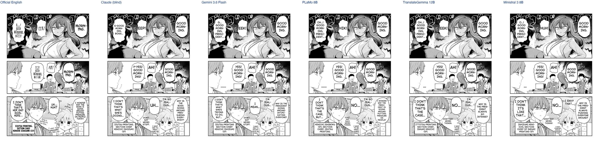

## The result

| | Pick | Why |
|---|---|---|
| Japanese to English, 16 GB+ RAM | **PLaMo 3 Translate 8B** (5.3 GB on disk) | Fewest mistakes of the local models on 2 of 3 chapters (tied on the third), and 3–4 times faster than TranslateGemma 12B. Only knows Japanese and English, and can't see the page |
| Any other pair, 16 GB+ RAM | **TranslateGemma 12B** (8.1 GB) | Best local model for Spanish to English, English to Spanish and Japanese to Spanish. Sees the page, so it fixes most of what the reader got wrong |
| 8 GB RAM | **PLaMo 3 Translate 2B** (Japanese to English), **Qwen3-VL 4B** (anything else) | Qwen3-VL sees the page; TranslateGemma 4B doesn't, and scored ~11 mistakes on Spanish to English |
| 32 GB+ RAM | PLaMo 31B, TranslateGemma 27B, Ministral 3 14B (**not tested yet**) | Until they're tested, 32 GB computers get the 16 GB picks as the default |
| Best quality overall | **Gemini, ChatGPT or Claude** with an API key | 0–1 mistakes. Gemini's free tier allows about 20 requests a day (about one chapter) |

The app picks the default this way (`get_default_model` in [translate.py](../translate.py)): the best model for the picked languages that fits the computer's RAM and is downloaded already or has room to be.

## Japanese to English (three chapters)

| Model | On disk | Sees the page | Shachou ch. 3 p. 1–3 (~34 lines) | Dragon Tofu ch. 24 p. 1–5 (21 lines) | Soul Anomaly ch. 1 p. 2–5 (~31 lines) | Seconds a page |
|---|---|---|---|---|---|---|
| Claude (blind subagent, reference) | cloud | yes | 0 | 1 | – | – |
| Gemini 3.6 Flash (free tier) | cloud | yes | 0 | 0 | – | 10–20 |
| **PLaMo 3 Translate 8B** (line by line) | 5.3 GB | no | 4 | **2** | **2** | **9–29** |
| **TranslateGemma 12B** | 8.1 GB | yes | 4 | 3 | 3 | 38–62 |
| Ministral 3 8B (the first default) | 6.0 GB | yes | 8 | 3 | – | 36–51 |
| Qwen3.5 9B | 7.6 GB | yes | 4 (the only local model with the boss as "she") | – | – | 67 |
| Gemma 4 12B | 7.7 GB | yes | 5 | – | – | 63 |
| PLaMo 3 Translate 2B (line by line) | 1.8 GB | no | 5 | – | – | 10 |
| TranslateGemma 4B (line by line) | 3.3 GB | no | – | 5 | 6 | 6 |
| Qwen3-VL 4B | 3.3 GB | yes | 7 | – | 6 | 26–36 |
| Hy-MT2 7B (line by line) | 4.6 GB | no | 6 | – | – | 22 |
| Ministral 3 3B | 3.0 GB | yes | 11 | – | – | 23 |
| TranslateGemma 4B in the page request | 3.3 GB | – | broken (copies the Japanese back) | – | – | – |
| Hy-MT2 1.8B | 1.1 GB | – | broken (repeats until Ollama stops it) | – | – | – |

- Gemma 4 and Qwen3.5 aren't offered: Ollama can't force their answer into the JSON the page request needs ("structured output is unavailable").
- Every local model breaks some names (石墨 = Ishizumi became "Ishiboku", "Stone", "graphite") and most call Shachou's female boss "he". A per-series name sheet belongs in spec 38.
- Typical mistakes: "Wow, what amazing people!" for わーすごい人だね ("look at all these people"), "Sit cross-legged!" (PLaMo) and "Sit down, loser!" (Ministral) for "Chanbo, sit down!", "can you come with me?" (TranslateGemma) for "go wake Yuichi up".

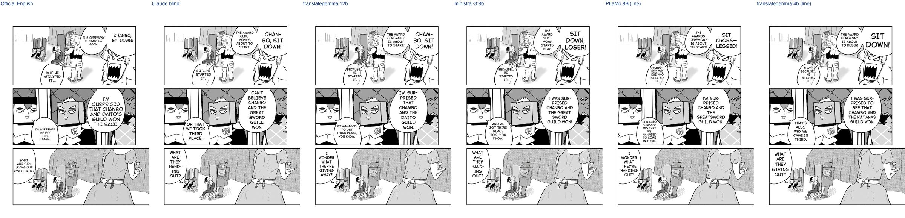
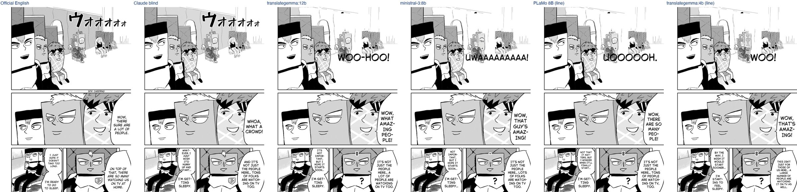
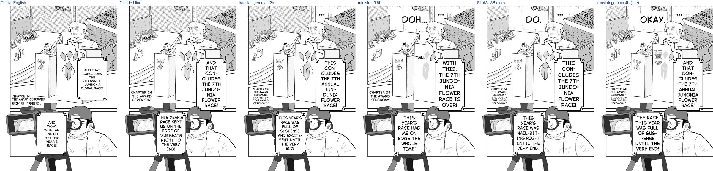
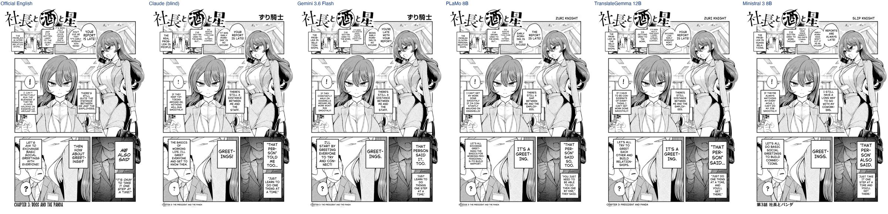
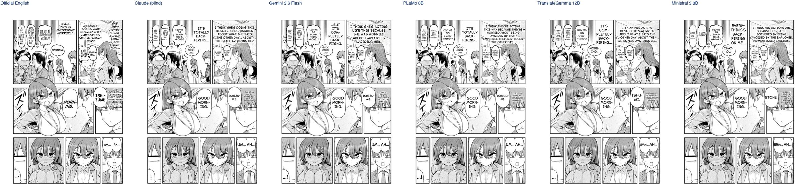
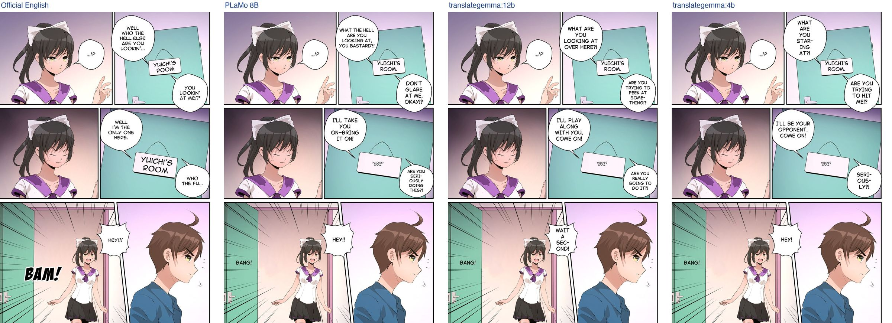

## Other language pairs (Soul Anomaly ch. 1, pages 2–5)

Soul Anomaly was written in English; the publisher's own group also posted it in Spanish and Japanese (the Japanese is a free localization). Full color. The Spanish counts are rough and are for a Spanish reader to check.

| Pair | TranslateGemma 4B (8 GB) | Qwen3-VL 4B (8 GB) | TranslateGemma 12B (16 GB) | PLaMo 8B (16 GB) |
|---|---|---|---|---|
| Spanish → English | ~11, 6 s | ~3, 26 s | **~1**, 35 s | – (Japanese only) |
| English → Spanish | ~3, 5 s | ~3, 27 s | **~1**, 34 s | – |
| Japanese → Spanish | ~6, 6 s | ~5, 28 s | **~4**, 41 s | – |
| Japanese → English | ~6, 6 s | ~6, 26 s | ~3, 40 s | **~2**, 16 s |

**The weak step for English and Spanish pages is reading, not translating.** Magi's reader was trained on printed English: it reads "¿Me estás mirando?" as "jme estas Mirando", "¿Puedes por favor despertar a Yuichi?" as "Yuna, episodes for favor desperate a yuichi", and made up whole sentences for boxes with no text at all (fixed, see below). Models that see the page fix most of it ("What are you looking at?"); line-by-line models can't ("Are you Miranda?"). A better reader for these languages is spec 36.

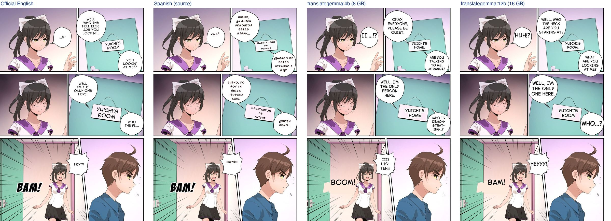
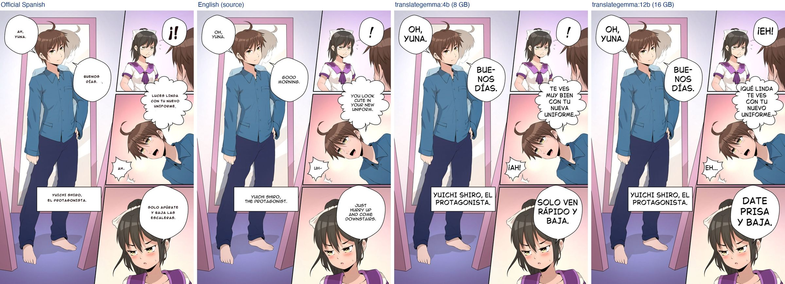
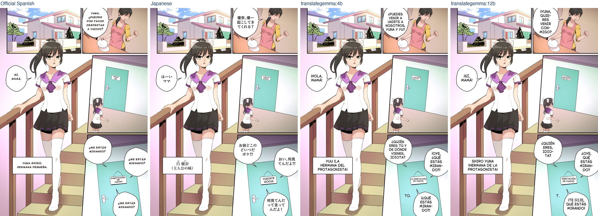

## Lettering problems found and fixed

Found on Dragon Tofu ch. 24 and Soul Anomaly ch. 1 after Shachou ch. 3 looked clean (no letters past a bubble, caption box or panel border on any of its 33 pages, checked zoomed in).

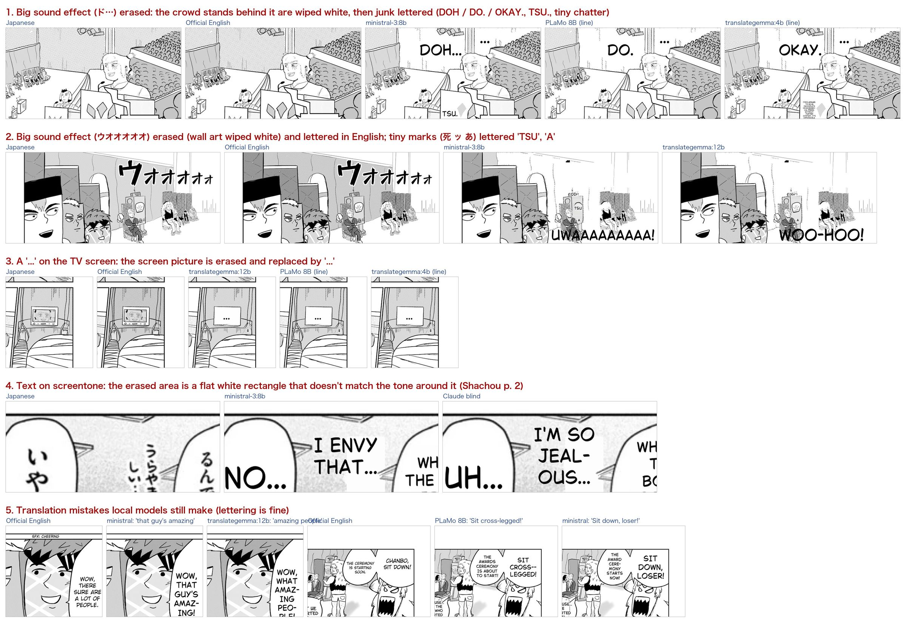
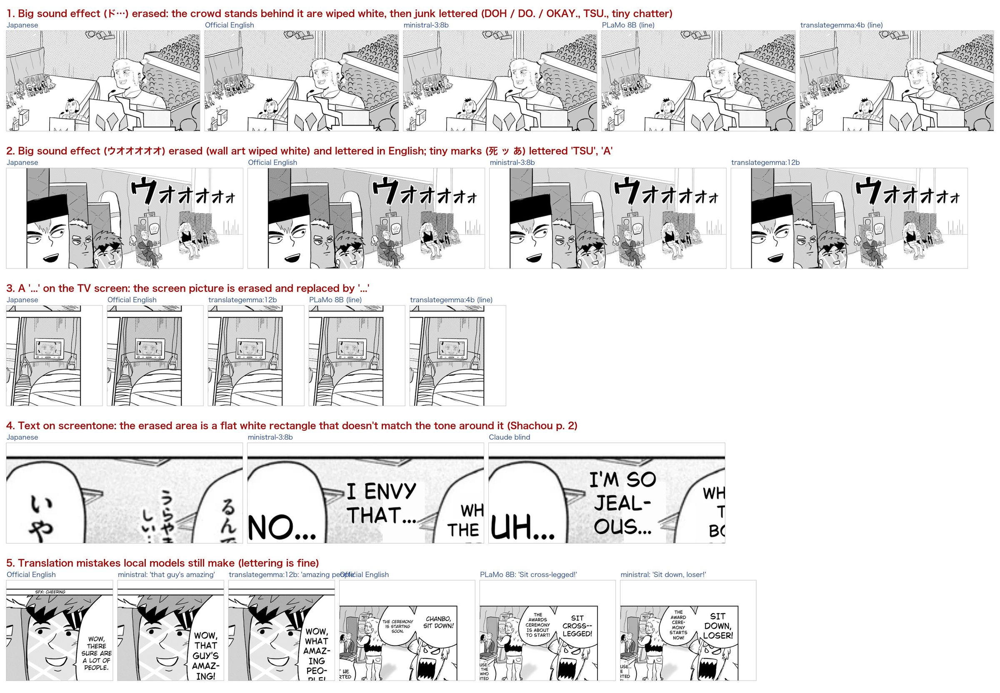

| Problem | Cause | Fix (in [translate.py](../translate.py)) |
|---|---|---|
| Text lettered on top of other text (a chapter title, "…GUILD WON") | Magi found one bubble twice, once "in the bubble" and once "on the art" | Two lines whose boxes overlap by half and whose text is almost the same become one (`remove_repeated_lines`) |
| "▯." lettered | The translator sent back Japanese (ド), which the fonts can't draw | Japanese in a translation is dropped; the line is empty if no letters are left (`remove_japanese`) |
| "Doh…", "Tsu", "A", "Okay." lettered over the art; a TV screen's picture erased and replaced by "…" | Lone marks on the art (ド, ッ, 死, あ, a "…" read off a drawn face) | Text on the art with fewer than 2 letters is left alone (`is_left_alone`) |
| The crowd's stands and the wall art wiped white; "WOO-HOO!" lettered over the art | Big sound effects (ウオオオオオ, ド) sit on a white wall or sky, which counted as a speech bubble, and erasing a bubble fills every drawing in it | A "bubble" line with letters over 8% of the page's height is left alone. The biggest real dialogue in the tests was 6%; the sound effects were 12–31% |
| "I have a few more of the" lettered on a roof (English and Spanish pages) | At Magi's low 0.1 threshold, its English reader makes up a sentence for a box with no text | English and Spanish pages use Magi's own 0.3 (Japanese keeps 0.1, which it needs for captions): every made-up line went, every real line stayed |
| "Yuichi'sroom" | Spaces were removed from everything Hayai read | Only spaces next to Japanese characters are removed |

**Still open:**
- **Big shouts:** a real shout in a big bubble (like One Piece's "PEOPLE'S DREAMS… DON'T EVER END!!", or a short big え!?) could pass the 8% rule and be left in Japanese. To check on more pages in the full-chapter run.
- **Screentone:** text erased from grey screentone leaves a flat white rectangle (every model, Claude too). LaMa would match the tone, but slower.
- **Names and genders** with local models (spec 38).

## How it was tested

| Step | How |
|---|---|
| Chapters | Listed in [test-chapters.md](test-chapters.md). Shachou ch. 3's Japanese pages come from Niconico's reader, saved with [save-canvas-pages.js](scripts/translate/save-canvas-pages.js) in the browser's console; the others come from MangaDex |
| Running a model | [scripts/translate/run_translate.py](scripts/translate/run_translate.py) (Japanese to English, first N pages) and [run_pair.py](scripts/translate/run_pair.py) (any pair, any pages), both timing the translator. Run one model at a time, `ollama stop <model>` after each, and check `memory_pressure` first: old processes once pushed the Mac 7 GB into swap and made a model 6 times slower |
| The Claude reference | Always from a **blind subagent** that only gets the numbered pages ([make_blind.py](scripts/translate/make_blind.py)) and the line list, never the official English. Its answer is lettered with [run_by_hand.py](scripts/translate/run_by_hand.py) |
| Re-lettering after a code change | [reletter.py](scripts/translate/reletter.py) letters a chapter again from a saved `translation.json`, without asking any model |
| Side-by-side images | [compare.py](scripts/translate/compare.py) |
| Downloads | [md_download.py](scripts/translate/md_download.py) `<chapter id> <folder>` |
