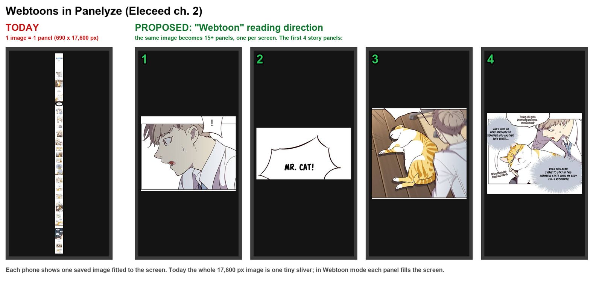
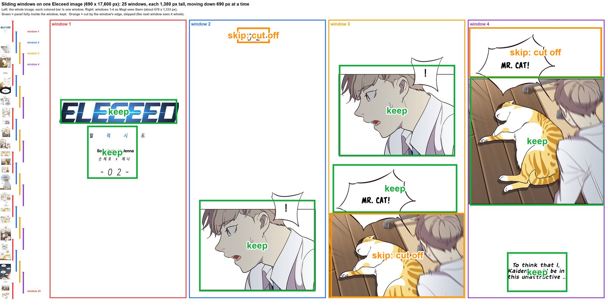
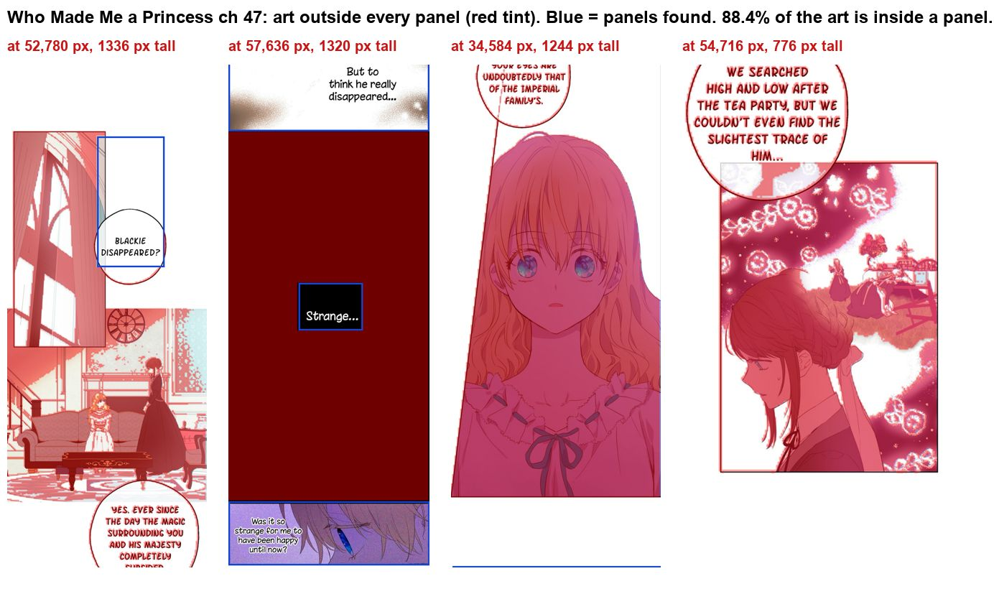
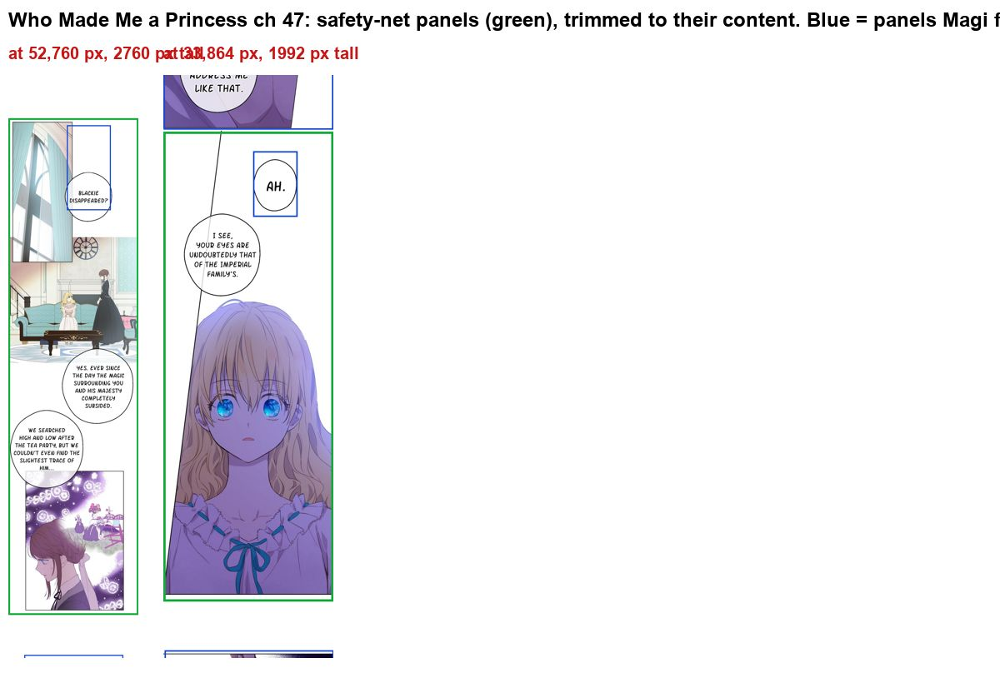
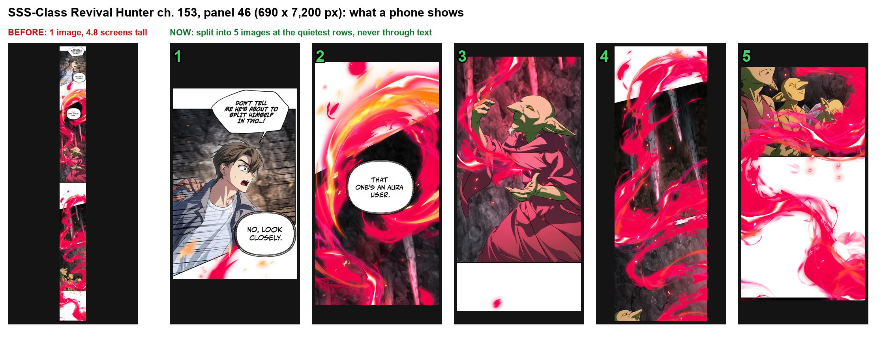
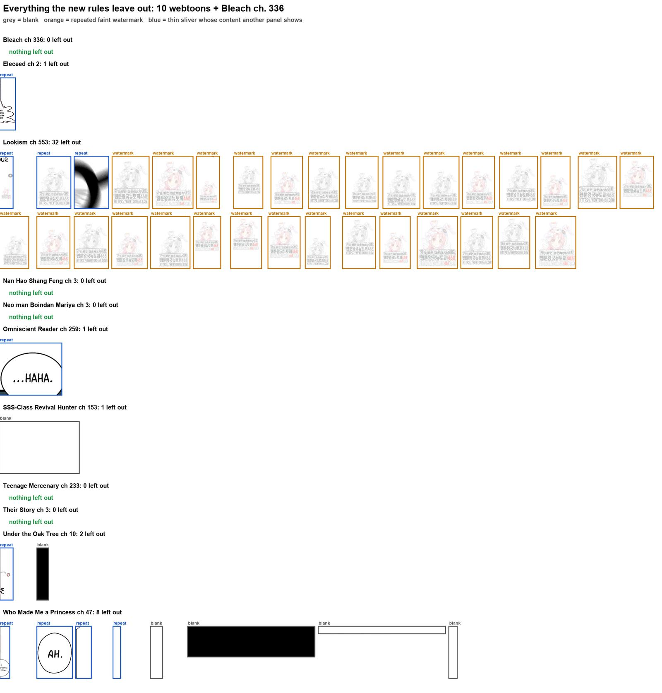

# Webtoons: splitting vertical-scroll comics into panels

Webtoons (Korean manhwa, Chinese manhua) are one long vertical strip, split into very tall image files. Panel-By-Panel couldn't handle them: it treated each image file as a page. The new **"Webtoon (Vertical scroll)"** reading direction fixes that. Tested on **10 chapters from 10 series**.

## Why it didn't work

Magi shrinks every image so its longest side is at most **1,333 px** before looking at it (`"longest_edge": 1333` in `magi_model/panels_config.json`). It was trained on manga pages that size.

| Image | Original | What Magi sees |
|---|---|---|
| Manga page | 1,100 x 1,600 | 917 x 1,333 (barely shrunk) |
| Eleceed webtoon image | 690 x 17,600 | **52 x 1,333** (panels become specks) |

So a 17,600 px image came out as **one "panel"**: the whole image, an unreadable sliver on a phone.

## How Webtoon mode works

1. **Join** the chapter's images into one long strip, at their most common width. Panels split between two image files become whole again.
2. **Slide a window** down the strip: 2 screens tall (2x the width), moving down 1 screen at a time. Each window is about the size Magi was trained on.
3. **Keep only whole panels.** A panel cut off by a window's edge is skipped, since the next window sees it whole. A panel taller than 1 screen is cut off in every window, so its pieces are joined back together.
4. **Remove duplicates** (the same panel found in two windows).
5. **Safety net** for art Magi missed: a blob of detailed art (lines, edges, text, not flat black or soft fades) touching a panel is added to that panel; any other blob becomes a panel of its own, trimmed to its content. Specks like watermarks are left out.
6. **Sort top to bottom** and save, like any chapter. Upscale Images and Images To Video work on them unchanged.

The speech bubble and character rules from [Panel cropping](panel-cropping.md) still run inside each window.

## Results: 10 chapters, the real app

| Webtoon | Style | Images | Strip height | Panels before | **Panels now** | Time | Peak memory |
|---|---|---|---|---|---|---|---|
| Eleceed ch. 2 | Action | 5 | 75,000 px | 5 | **140** | 41 s | 1.7 GB |
| Who Made Me a Princess ch. 47 | Romance fantasy | 17 | 70,000 px | 69 | **100** | 36 s | 1.8 GB |
| Lookism ch. 553 | Action / drama | 50 | 282,000 px | 132 | **213** | 101 s | 3.2 GB |
| Omniscient Reader ch. 259 | Action fantasy, "system windows" | 44 | 93,000 px | 112 | **98** | 49 s | 1.8 GB |
| SSS-Class Revival Hunter ch. 153 | Action | 12 | 101,000 px | 76 | **103** | 52 s | 1.9 GB |
| Teenage Mercenary ch. 233 | Gritty action, dark scenes | 16 | 122,000 px | 71 | **140** | 60 s | 2.5 GB |
| Under the Oak Tree ch. 10 | Painterly romance (28,800 px images) | 7 | 202,000 px | 8 | **131** | 65 s | 3.1 GB |
| Neo man Boindan Mariya ch. 3 | Modern rom-com | 20 | 127,000 px | 104 | **177** | 63 s | 2.2 GB |
| Nán Hào Shàng Fēng ch. 3 | Chinese comedy (page-sized images) | 23 | 27,000 px | 42 | **41** | 14 s | 1.8 GB |
| Their Story ch. 3 | Chinese, short strips | 4 | 3,100 px | 8 | **8** | 5 s | 1.3 GB |

"Panels now" is the final result: very tall panels split for phones, and blank, watermark and repeated panels left out (see below). Times and memory were measured before those two steps, which add little. "Panels before" counts each whole image as Magi saw it. Omniscient Reader and Nán Hào Shàng Fēng have *fewer* panels now because "before" also counted the halves of panels split between two image files.

## Was anything lost?

To check, the detailed art (lines, edges, text) of each chapter was compared with what ends up inside a panel:

| Webtoon | Art inside a panel, windows only | **With the safety net** | Pieces added to a panel | Extra panels |
|---|---|---|---|---|
| Eleceed ch. 2 | 99.5% | **99.8%** | 10 | 0 |
| Who Made Me a Princess ch. 47 | 93.0% | **100%** | 2 | 2 |
| Lookism ch. 553 | 96.2% | **99.9%** | 25 | 8 |
| Omniscient Reader ch. 259 | 99.0% | **99.9%** | 17 | 1 |
| SSS-Class Revival Hunter ch. 153 | 98.9% | **100%** | 10 | 3 |
| Teenage Mercenary ch. 233 | 99.7% | **100%** | 10 | 0 |
| Under the Oak Tree ch. 10 | 98.3% | **99.9%** | 37 | 7 |
| Neo man Boindan Mariya ch. 3 | 99.1% | **99.9%** | 21 | 1 |
| Nán Hào Shàng Fēng ch. 3 | 100% | **100%** | 0 | 0 |
| Their Story ch. 3 | 100% | **100%** | 0 | 0 |

Who Made Me a Princess lost 4 soft-edged, borderless panels with windows alone. The picture below is a **close-up of only those missed spots**, not the whole chapter: red is art no panel covers, blue is panels Magi found. Magi didn't box them as panels at all. (Its title says 88.4%, from a first measurement that counted any non-white pixel, plain backgrounds included. The table above uses the later measurement, detailed art only: 93.0%.)

The safety net (our code, not Magi) finds that art straight from the pixels and makes panels from it (green), though as 2 tall slices rather than 4 separate panels:

### How the safety net was tuned

| Version | Problem | Fix |
|---|---|---|
| Any non-white art counts | Empty black screens and gradient fades became "panels" | Only **detailed** art counts (lines, edges, text) |
| Rows of missed art become full-width slices | Thin slices cut through panels | Blobs of missed art, **trimmed to their content** |
| Every blob becomes its own panel | A panel's own border line, just outside Magi's box, joined into one huge blob; bubbles sticking out of a panel became separate crops repeating part of it | Art within 24 px of a panel is the panel's; a blob **touching a panel is added to it** |
| Small blobs kept | Lookism's repeated watermark icon became 11 tiny images | Blobs smaller than 160 x 160 px are left out |

## Very tall panels are split for phones

A phone screen is about 2.2 times taller than wide. Most webtoon panels fit one screen, but some art flows down through several panels, and keeping it whole made panels up to **4.8 screens tall**. On a phone that fits the whole image on screen, that's a thin strip with unreadable text.

| Panel height (10 chapters, 1,178 panels) | Panels |
|---|---|
| Fits one phone screen | 1,047 (89%) |
| 1-2 screens | 114 (10%) |
| 2-4 screens | 16 (1.4%) |
| 4+ screens | 1 |

So panels taller than **2 phone screens** are split into screen-sized pieces ("Split very tall panels for phones", on by default):

1. Split into the fewest pieces that each fit about one screen.
2. Each cut goes at the **quietest rows** near an even split: white space, a panel border, little detail.
3. **Never through text:** Magi's text boxes from the same pass are kept, and no cut is allowed within 12 px of one. Art can be cut, since the rest of it is in the next piece.
4. Nothing is left out: the pieces together are the whole panel.

| Webtoon | Panels | With very tall panels split | Tallest panel now |
|---|---|---|---|
| Eleceed ch. 2 | 141 | 141 | 1.6 screens |
| Who Made Me a Princess ch. 47 | 108 | 118 | 1.8 |
| Lookism ch. 553 | 244 | 245 | 1.9 |
| Omniscient Reader ch. 259 | 97 | 99 | 1.9 |
| SSS-Class Revival Hunter ch. 153 | 98 | 107 | 1.8 |
| Teenage Mercenary ch. 233 | 136 | 142 | 1.7 |
| Under the Oak Tree ch. 10 | 130 | 140 | 1.9 |
| Neo man Boindan Mariya ch. 3 | 175 | 177 | 1.5 |
| Nán Hào Shàng Fēng ch. 3 | 41 | 41 | 0.6 |
| Their Story ch. 3 | 8 | 8 | 0.3 |

It applies to every reading direction, but no manga panel in the 25 test chapters comes close to 2 screens (a full-page manga splash is about 0.7).

## Panels with nothing to read are left out

Some "panels" Magi finds have nothing in them worth a swipe. Three narrow rules leave them out, each built so it can't remove real content:

| Rule | Leaves out | Why it can't remove real content |
|---|---|---|
| **Blank** | A panel that's almost one flat color (all white, all black) | A character on a white background, like Kubo's pages in Bleach, isn't one flat color |
| **Repeated faint watermark** | A faint image (under 2% dark pixels) with 3+ near-identical copies in the chapter, like the logo an uploader stamped between Lookism's panels about 30 times | Copy-pasted story panels repeat too (Their Story has 4 near-identical ones), but they have dark lines, so they're never faint. Faint art like falling petals is never identical. |
| **Repeated sliver** (webtoons) | A sliver under 30% of the strip's width whose content another panel shows: its text is inside another panel, or 80% of it is, and under 5% of its detailed art is new | Needs proof it's shown elsewhere. A first version only checked "little detail" and dropped Under the Oak Tree's soft petals and full-size Lookism panels; both are kept now. |

Bold repeated images aren't left out: a bold "please support me" banner shown 3 times is a little annoying, but real story panels can be just as identical, so no rule could tell them apart.

| Chapter | Panels | Blank | Watermark | Repeated sliver |
|---|---|---|---|---|
| Eleceed ch. 2 | 140 | 0 | 0 | 1 (the end of a bubble the next panel shows whole) |
| Who Made Me a Princess ch. 47 | 100 | 4 | 0 | 4 |
| Lookism ch. 553 | 213 | 0 | **29** | 3 |
| Omniscient Reader ch. 259 | 98 | 0 | 0 | 1 |
| SSS-Class Revival Hunter ch. 153 | 103 | 1 | 0 | 0 |
| Teenage Mercenary ch. 233 | 140 | 0 | 0 | 0 |
| Under the Oak Tree ch. 10 | 131 | 1 | 0 | 1 |
| Neo man Boindan Mariya ch. 3 | 177 | 0 | 0 | 0 |
| Nán Hào Shàng Fēng ch. 3 | 41 | 0 | 0 | 0 |
| Their Story ch. 3 | 8 | 0 | 0 | 0 |
| **Bleach ch. 336** (manga, mostly white backgrounds) | 80 | 0 | 0 | 0 |

Everything left out, checked by eye:

## Webtoons picked as manga are detected

If most of a chapter's images are more than 2.5 times taller than wide, Panel-By-Panel uses Webtoon mode whatever reading direction was picked, and says so in the log. A manga page is about 1.4 times taller than wide; the test webtoons' images were 3 to 25 times. Eleceed ch. 2 picked as "Right to left (Manga)" gave the same 141 panels as Webtoon mode. The two Chinese webtoons with page-sized images aren't detected, and don't need to be: they come out the same either way.

## Limits

| Limit | Details |
|---|---|
| Slower than manga | 5–100 s per chapter (most about 1 minute), vs about 11 s for a manga chapter. The strip is 3,000–280,000 px tall. |
| Memory | Peak 1.3–3.2 GB. The whole chapter is held as one image. |
| Floating speech bubbles | Bubbles in the white space between panels ("MR. CAT!") come out as their own images. Fine for reading and video. |
| Soft-edged panels Magi misses | Recovered by the safety net, but neighbors can come out as one slice (split into screen-sized pieces if it's very tall) |
| Video text | A strip is far too tall for Magi to read its text in one go, so Images To Video reads the text from the panels instead (slower than manga, where the text is read from whole pages). |
| Scanlator pages | Credits and ad pages become panels, the same as with manga |
| Upscaling | Webtoons are full color, so "Best" upscaling uses the slower color model (see [Upscaling](upscaling.md)) |
